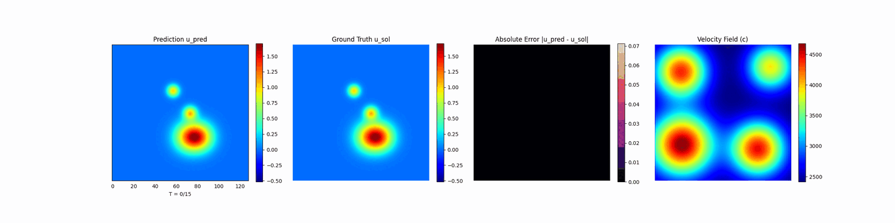
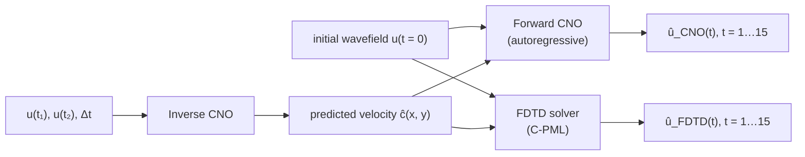
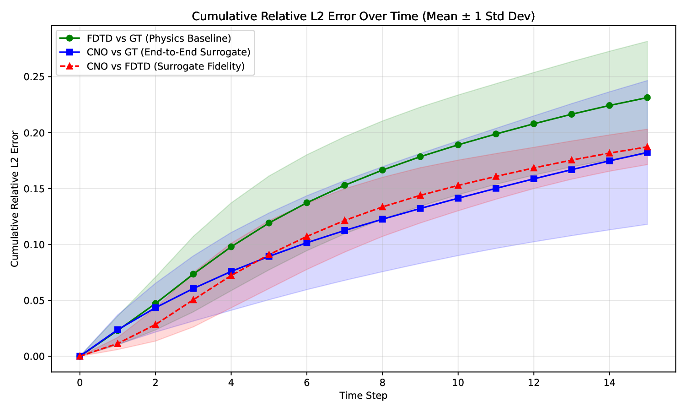
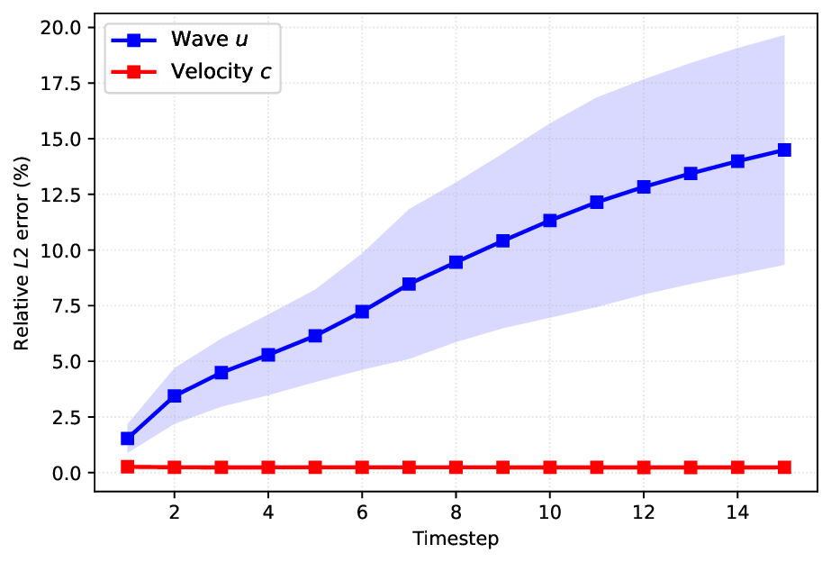
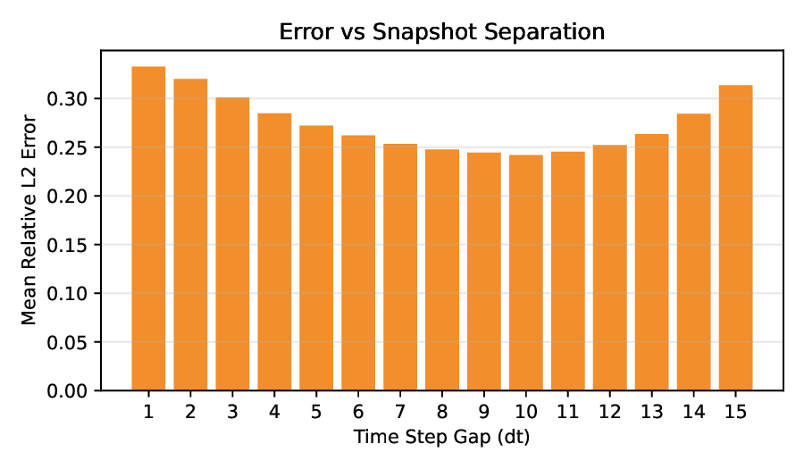
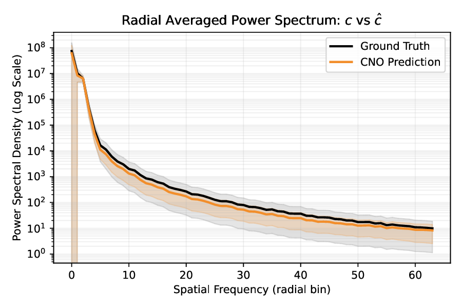

# Closed-loop acoustic wave modelling with Convolutional Neural Operators

Semester project, ETH Zurich (2026). Two
[Convolutional Neural Operators](https://github.com/camlab-ethz/ConvolutionalNeuralOperator)
(CNOs) close the loop between the inverse and the forward problem of 2D acoustic
wave propagation:

1. An **inverse CNO** estimates the hidden velocity field c(x, y) of the medium
   from just **two snapshots** of a propagating wave.
2. A **forward CNO** uses that estimate to simulate the rest of the wave's
   evolution, autoregressively.

The question: does an imperfect estimate of the medium still give stable,
accurate forward predictions, and how does the neural solver compare with a
classical finite-difference (FDTD) solver given the same estimate?

<p align="center">
  
</p>
<p align="center"><em>Forward CNO, 15-step autoregressive rollout on a test trajectory: prediction, ground truth, absolute error and velocity field.</em></p>

## Pipeline



Data: 5,256 simulated trajectories of the Wave-Gauss problem, with 15 time steps
on a 128 × 128 grid. The velocity field is a background plus four Gaussian
inclusions, and the waves start from two to six Gaussian pulses. Training uses
all time pairs (t₁ < t₂) of each trajectory. All results below are on the 120
held-out test trajectories.

## Results

| Stage | Result |
|---|---|
| Forward CNO, true velocity | 1.5 % one-step relative L2 error; 14 % cumulative relative L2 error after a 15-step autoregressive rollout; the velocity channel stays at 0.24 % |
| Inverse CNO, two snapshots | 28 % relative L2 error in ĉ overall; lowest (about 24 %) when the snapshots are about 9–10 steps apart |
| Closed loop (step 15) | see the table below |

**Closed loop:** cumulative relative L2 error of the wavefield at the last step.

| Solver | true velocity c | velocity ĉ from the inverse CNO (Δt = 9) |
|---|---|---|
| Forward CNO | 14 % | **18 %** |
| FDTD on the 128 × 128 grid | 16.7 % ¹ | 23 % |

¹ The ground truth was simulated on a finer grid (256 × 256, dx = 20 m) and
downsampled. On the CNO's 128 × 128 grid (dx = 40 m), the FDTD solver already
has this error with the *true* velocity field. I computed this number after the
report, with `python -m cno_closed_loop.closed_loop.fdtd_floor`. At matched
resolution, the CNO is therefore more accurate, and the estimated velocity costs
it less accuracy than it costs the FDTD solver (+4 vs. +6 percentage points).

<table>
  <tr>
    <td width="50%"><br><em>Closed loop: error over time for FDTD vs. ground truth, CNO vs. ground truth, and CNO vs. FDTD.</em></td>
    <td width="50%"><br><em>Forward CNO with the true velocity: error accumulates roughly linearly, while the velocity channel stays fixed.</em></td>
  </tr>
  <tr>
    <td><br><em>Inverse CNO: snapshots too close together have not yet sampled the medium; snapshots too far apart lose track of the wave path.</em></td>
    <td><br><em>Power spectra of c and ĉ: the inverse CNO acts as a low-pass filter and adds no high-frequency (aliasing) artefacts.</em></td>
  </tr>
</table>

**Takeaways**

- The inverse CNO finds the positions and shapes of the velocity inclusions but
  smooths their peaks. Its errors are smooth and ring-shaped, with no spurious
  high frequencies.
- Wave kinematics depend mostly on this large-scale structure, so both forward
  solvers stay stable even with a velocity estimate that is 28 % off.
- The forward CNO tolerates the estimation error better than the FDTD solver
  does at the same resolution.

## What I built and what I reused

**Reused**

| Component | Source |
|---|---|
| CNO architecture, Lightning training loop, data-loading framework | [camlab-ethz/ConvolutionalNeuralOperator](https://github.com/camlab-ethz/ConvolutionalNeuralOperator) (MIT), used through the submodule `external/CNO` |
| Alias-free filters / CUDA operators inside the CNO | NVIDIA StyleGAN3 code (NVIDIA Source Code License), part of the CNO repository |
| FDTD acoustic solver with C-PML | Ben Moseley's Python port (MIT) of SEISMIC_CPML (Komatitsch & Martin), vendored in `external/seismic_cpml` |
| Wave-Gauss data generator | unpublished script by Bogdan Raonić, which I parallelized; not included |

**My work**

| Component | Where |
|---|---|
| HDF5 Wave-Gauss support in the CNO (fork branch `closed-loop-waves`) | `external/CNO` |
| Forward CNO training setup with live rollout monitoring | `cno_closed_loop/forward/train.py` (adapted from the CNO training script) |
| Inverse problem: dataset (u(t₁), u(t₂), Δt) → c, configuration, training, `InverseCNO` | `cno_closed_loop/inverse/` (dataset, configuration and training adapted from CNO counterparts) |
| Forward evaluation: autoregressive rollouts, cumulative errors, energy and phase-drift diagnostics, visualizations | `cno_closed_loop/forward/` |
| Inverse evaluation: error vs. snapshot gap, error maps, radially averaged power spectrum | `cno_closed_loop/inverse/evaluate.py` |
| Closed loop: inverse CNO → forward CNO / FDTD, GPU timing, comparison, FDTD error floor | `cno_closed_loop/closed_loop/` |
| SLURM pipeline | `scripts/slurm/` |

Details and licences: [`THIRD_PARTY_NOTICES.md`](THIRD_PARTY_NOTICES.md).

**AI assistance.** Parts of the code were written with the help of AI coding
assistants. The repository was restructured and cleaned up for this public
release with Claude; those commits are marked as co-authored.

## Repository layout

```
cno_closed_loop/
  paths.py                  data / checkpoint / results folders (env vars CNO_CL_*)
  forward/                  train.py, model_loader.py, evaluate_rollout.py, visualize.py
  inverse/                  model.py, dataset.py, config.py, train.py, evaluate.py, visual_check.py
  closed_loop/              compare_cno_vs_fdtd.py, resimulate_fdtd.py, fdtd_floor.py
external/
  CNO/                      submodule: CNO code (fork, branch closed-loop-waves)
  seismic_cpml/             vendored FDTD solver (B. Moseley, MIT)
scripts/slurm/              train_forward.sh, train_inverse.sh, evaluate.sh
data/README.md              dataset format and how it was generated
docs/                       report and figures
```

## Running it

```bash
git clone --recurse-submodules https://github.com/sourcherry7/cno-closed-loop-acoustic-waves.git
cd cno-closed-loop-acoustic-waves
python -m venv .venv && source .venv/bin/activate      # Python 3.11
pip install -r requirements.txt
```

The dataset and trained weights are not distributed; see [`data/README.md`](data/README.md)
for the expected format. By default the code uses `./data`, `./checkpoints` and
`./results`; override them with `CNO_CL_DATA_DIR`, `CNO_CL_CHECKPOINT_DIR` and
`CNO_CL_RESULTS_DIR`.

```bash
python -m cno_closed_loop.forward.train                    # train the forward CNO (GPU)
python -m cno_closed_loop.inverse.train                    # train the inverse CNO (GPU)
python -m cno_closed_loop.forward.evaluate_rollout         # forward rollout errors
python -m cno_closed_loop.inverse.evaluate                 # inverse diagnostics
python -m cno_closed_loop.closed_loop.compare_cno_vs_fdtd  # closed loop, CNO vs. FDTD (GPU)
python -m cno_closed_loop.closed_loop.fdtd_floor           # FDTD error floor (CPU, ~2 min)
```

Optional extras: `PHYSICS_DIAGNOSTICS = True` in `forward/evaluate_rollout.py` adds the energy
and phase-drift diagnostics, and `SAVE_TRAJECTORY_PLOTS = True` in `closed_loop/resimulate_fdtd.py`
saves per-trajectory figures.

On a SLURM cluster, submit from the repository root:
`mkdir -p results/logs && VENV=/path/to/venv sbatch scripts/slurm/train_forward.sh`
(likewise `train_inverse.sh` and `evaluate.sh`).

## Limitations

- **Simple media.** The media are smooth and synthetic, with exactly four
  Gaussian inclusions. Layered media with sharp interfaces are likely much harder
  to invert from two snapshots.
- **Simulated ground truth.** The ground truth is itself a numerical
  simulation, so the CNO learns to imitate that solver.
- **Matched resolution.** The CNO vs. FDTD accuracy comparison is at the CNO's
  resolution (see footnote ¹). A finer FDTD grid would be more accurate, at a
  higher cost.

## Report

The full write-up is in [`docs/report.pdf`](docs/report.pdf): *Convolutional
Neural Operators for Closed-Loop Modeling of Acoustic Wave Propagation: Stability
and Robustness of Forward Resimulation from Inverse Predictions* (S. Višnjić, 2026).

## References

- B. Raoni&#263; et al., "Convolutional Neural Operators for robust and accurate learning of PDEs", NeurIPS 2023.
- T. Karras et al., "Alias-Free Generative Adversarial Networks", NeurIPS 2021.
- R. Martin and D. Komatitsch, "An unsplit convolutional perfectly matched layer improved at grazing incidence for the seismic wave equation", *Geophysics* 74(5), 2009.
- B. Moseley, A. Markham, T. Nissen-Meyer, "Finite basis physics-informed neural networks (FBPINNs)", *Adv. Comput. Math.*, 2023.

## License

MIT for the code in `cno_closed_loop/` and `scripts/` (see [`LICENSE`](LICENSE)).
Third-party code keeps its own licence (see [`THIRD_PARTY_NOTICES.md`](THIRD_PARTY_NOTICES.md)).
